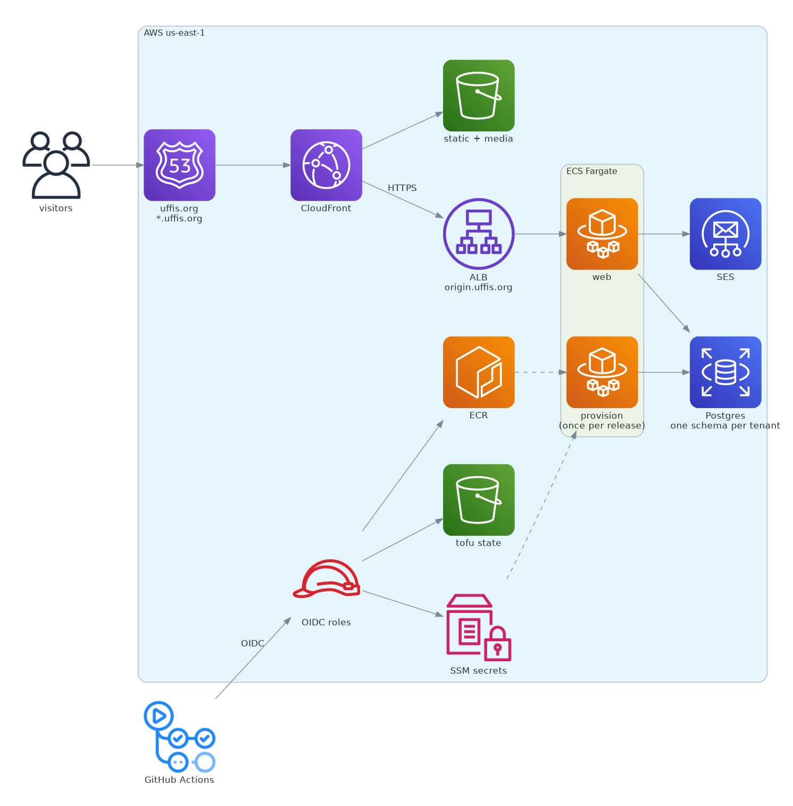

# uffis-portal

Multi tenant [Tethys Platform](https://www.tethysplatform.org/) portal for UFFIS. The apex
`uffis.org` serves the public forecast viewer; each agency gets `<tenant>.uffis.org`, isolated by
Postgres schema with `django-tenants`.

The image builds FROM [`tethys-uvx`](https://github.com/Aquaveo/tethys-uvx) and the infrastructure
is the shared [`tethys-ecs-iac`](https://github.com/Aquaveo/tethys-ecs-iac) OpenTofu module. This
repo holds the UFFIS image, config, tenancy hooks, tfvars and CI.



`conf/` holds the portal config, the hooks the base image runs (`portal-config.d/` at start,
`init.d/` once per release) and the Python modules named below. `tofu-rds/` and `tofu-iam/` are
applied once by hand with admin credentials. The diagram is `docs/architecture.py`.

## Tenancy

- **One connection, one tenant.** `django-tenants` picks the tenant with `SET search_path`, so
  `db_pool_mode` must stay `direct`; `portal-config.d/05-tenancy.sh` refuses to start otherwise. It
  also sets the database engine, which the base overwrites from the environment.
- **Provisioning** (`init.d/10-tenancy.sh`) registers the apex domains, harvests apps into every
  tenant schema, seeds new tenants' site settings once, creates the `Portal Access` group, and
  provisions the persistent stores. `tethys db migrate` already migrates every schema.
- **Persistent stores** share one database per app, so `provision_tenant_store.py` isolates them
  with a role and schema per tenant, and asserts on `current_schema()`.
- **Media** is prefixed per tenant (`TenantMediaS3Storage`); static is shared.
- **Hosts:** the CloudFront alias is `*.uffis.org`, `ALLOWED_HOSTS` takes `.uffis.org`, CSRF takes
  `https://*.uffis.org`. Unknown hosts get the public portal (`SHOW_PUBLIC_IF_NO_TENANT_FOUND`),
  which keeps the ALB health check at 200, so any 404 means something is broken.
- Several Tethys commands exit 0 on failure (`create_tenant`, `syncstores`), so the hooks check
  their output. Read task logs, not exit codes.

## Setup

No account identifiers are committed; the lint workflow rejects them. The `.example` files carry
`__TOKEN__` placeholders and the deploy workflow fills them in at run time from:

- **Variables:** `AWS_REGION`, `ECR_REPOSITORY`, `TOFU_STATE_BUCKET`, `PORTAL_DOMAIN`
- **Secrets** (masked in the public logs): `AWS_ACCOUNT_ID`, `VPC_ID`, `SUBNET_IDS` (JSON array),
  `ACM_CERTIFICATE_ARN`, `DB_HOST`, `SES_SMTP_USER`, `AWS_ROLE_ARN`, `AWS_DEPLOY_ROLE_ARN`
- **App secrets**, copied to SSM by `sync secrets`: `DB_PASSWORD`, `PS_CONNECTION`, `SECRET_KEY`,
  `SUPERUSER_PASSWORD`, `EMAIL_PASSWORD`

Use admin SSO credentials, exported for OpenTofu, which does not refresh SSO tokens:

```bash
aws sso login --sso-session <session> && export AWS_PROFILE=<admin-profile> AWS_REGION=us-east-1
eval "$(aws configure export-credentials --profile "$AWS_PROFILE" --format env)"
```

1. **Database.** `tofu-rds/` has its own state, deletion protection and a final snapshot. Set
   `TF_VAR_master_password` (also the `DB_PASSWORD` secret), apply, and store `db_host` as
   `DB_HOST`. It is private; its only ingress is the portal's web security group (step 5).
2. **Certificate.** Request `uffis.org` + `*.uffis.org` in ACM `us-east-1`, add the one validation
   CNAME in the `uffis.org` zone, and store the ARN as `ACM_CERTIFICATE_ARN`.
3. **CI roles.** Fill `tofu-iam/uffis.tfvars` from the example (the org and repo ids come from
   `gh api orgs/Aquaveo --jq .id` and `gh api repos/Aquaveo/uffis-portal --jq .id`; GitHub's OIDC
   subject uses them) and apply. Store `ecr_role_arn` and `deploy_role_arn` as `AWS_ROLE_ARN` and
   `AWS_DEPLOY_ROLE_ARN`. The push role trusts `main` and `v*` tags; the deploy role trusts only
   the `production` environment, which allows `main` only and requires a reviewer.
4. **Secrets.** Set the app secrets and run `gh workflow run sync-secrets.yml`.
5. **First deploy.** Run `tofu deploy` with a built `image_tag` (below). The first provision fails
   waiting for the database, so open it to the new web security group and deploy again:

   ```bash
   IAC=../tethys-ecs-iac/tofu
   tofu -chdir=$IAC init -reconfigure -backend-config="$PWD/tofu/backend.hcl"
   tofu -chdir=tofu-rds apply -var vpc_id=<vpc-id> -var 'subnet_ids=["<a>","<b>"]' \
     -var web_security_group_id="$(tofu -chdir=$IAC output -raw web_security_group)"
   ```

   `-reconfigure` matters: the module directory may still point at another portal's state.
6. **DNS.** A and AAAA alias records for `uffis.org` and `*.uffis.org` to CloudFront (zone
   `Z2FDTNDATAQYW2`), and `origin.uffis.org` as a CNAME to the ALB. CloudFront reaches the ALB over
   TLS on that name, the ALB sets `X-Forwarded-Proto`, and it accepts only CloudFront.
7. **Verify.** `curl -sSI` on `https://uffis.org/`, `https://abms.uffis.org/` and
   `https://nope.uffis.org/` should all return 200.

### Adding a tenant

Tenants are listed in `conf/agencies.py`, which also drives the apex directory. Use one label under
the apex (the wildcard certificate covers it) and a hyphen, never an underscore, in the hostname.
Create the schema with a one-off provision task. The override must call `portal-config.sh` first,
because it replaces the container command:

```bash
IAC=../tethys-ecs-iac/tofu
SUBNETS=$(tofu -chdir=$IAC output -json service_subnets | jq -r 'join(",")')
SG=$(tofu -chdir=$IAC output -raw web_security_group)
CMD="/usr/local/bin/portal-config.sh && tethys manage create_tenant --schema_name abms \
  --name 'Antigua and Barbuda' --domain-domain abms.uffis.org --domain-is_primary True"
aws ecs run-task --cluster "$(tofu -chdir=$IAC output -raw ecs_cluster)" \
  --task-definition "$(tofu -chdir=$IAC output -raw provision_task_definition)" --launch-type FARGATE \
  --network-configuration "awsvpcConfiguration={subnets=[$SUBNETS],securityGroups=[$SG],assignPublicIp=ENABLED}" \
  --overrides "{\"containerOverrides\":[{\"name\":\"provision\",\"command\":[\"bash\",\"-lc\",\"$CMD\"]}]}"
```

Check the task log, then run `tofu deploy` (apps, settings, access group) and `grant admins`.

## Day to day

- **Deploy:** a merge to `main` builds `uffis-<short sha>`. Run `tofu deploy` with that
  `image_tag`, `plan` then `apply`, approving each run for `production`.
- **Pins:** tethysdash, `tgf_wmo_plugins` and the UFFIS Forecasts app are pinned by commit in the
  Dockerfile (a cloned branch is not cache safe). The `bump pins` workflow resolves new commits
  every Monday or on demand and opens one PR; set `PINS_TOKEN` if `lint` should run on it. Locally,
  rebuild with `docker build --no-cache-filter builder,runtime`.
- **Base image and module:** bump `BASE_BUILDER`/`BASE_TAG` in the Dockerfile and the `iac_ref`
  default in `tofu-deploy.yml` deliberately; both are pinned so a plan cannot drift before apply.
- **Secrets:** update the GitHub secret, then run `sync secrets`.
- **Pause a tenant:** add its schema to `conf/paused_tenants.py` and deploy; its data is kept.
  `bms` (Barbados) is paused.
- **Branding:** `aws s3 cp branding/<schema>/ s3://uffis-portal-static/static/tenants/<schema>/
  --recursive`, then reference `tenants/<schema>/<file>` in the tenant's site settings. The shared
  masthead is a public domain NASA MODIS image; only an agency's own logo is rehosted.
- **Run locally:** `docker compose -f local/compose.yml up --build -d` serves the apex at
  `localhost:8000` and ABMS at `abms.localhost:8000`, with `conf/` and a sibling
  `tethysapp-uffis_forecasts` checkout mounted. Browser check: `node local/apex_smoke.mjs`.

## Accounts

Accounts are requested, not created (`conf/account_requests.py`):

    register  ->  inactive account, confirmation link emailed
    confirm   ->  that tenant's staff are emailed
    approve   ->  a staff user activates it and adds it to Portal Access

Links are signed per user and schema (three days to confirm, thirty to approve), and approval needs
a staff session. Pending requests are the user list filtered by `is_active__exact=0`.

Accounts are per tenant, because `auth_user` is per schema. The `grant admins` workflow creates the
administrators in every tenant schema from the `PORTAL_ADMINS` secret or an input; it is safe to
re-run and masks addresses in the log:

```bash
gh workflow run grant-admins.yml -R Aquaveo/uffis-portal
gh workflow run grant-admins.yml -R Aquaveo/uffis-portal -f admins=director@agency.example.org -f tenants=abms
```

Administrators set their password through Forgot password, once per tenant.

**App access** is an object level permission that Tethys grants only through groups. A user made by
hand in the admin reaches no app until it is added to `Portal Access` and marked Active; ticking
permissions on the User page does nothing. Superusers bypass the check, so test with a normal user.

**Mail** goes through SES (`conf/email_settings.py`). A partial mail config fails at boot rather
than at send time, where Django would report success. All mail leaves from one verified sender,
`DEFAULT_FROM_EMAIL`; put the display name in `EMAIL_FROM`, never in `DEFAULT_FROM_EMAIL`.

## The apex

`uffis.org` is the public schema: a directory of agencies at `/` and the UFFIS Forecasts viewer at
`/viewer/`, in English, French or Spanish (`?lang=`, then cookie, then browser). Accounts, apps and
the admin answer 404 there (`conf/public_gate.py`), and tenants never see the viewer. Translations
live in `conf/locale/`; the build fails on untranslated strings.

Account pages and the CSRF failure page are themed per tenant from `conf/portal_templates/`, which
shadows Tethys's templates by name. Keep them in step when Tethys changes its own.

## Known limits

- Media is per tenant but public: anyone with an object URL can fetch it.
- Anyone with `ecs:RunTask` on the provision task, the deploy role included, can create a superuser
  in any tenant.
- A mistyped tenant subdomain shows the public portal rather than a 404.
